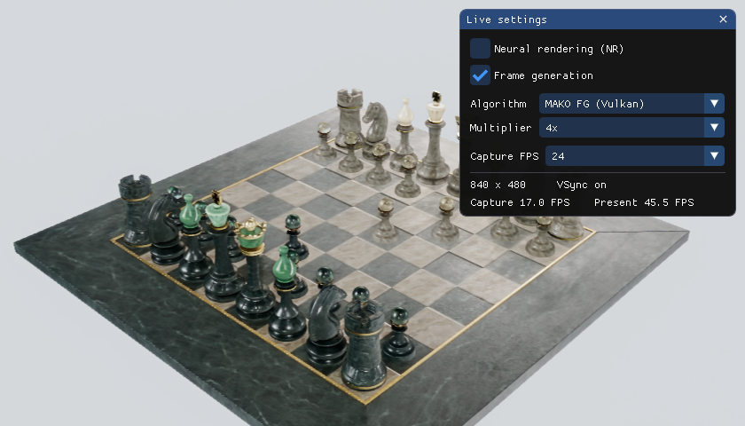
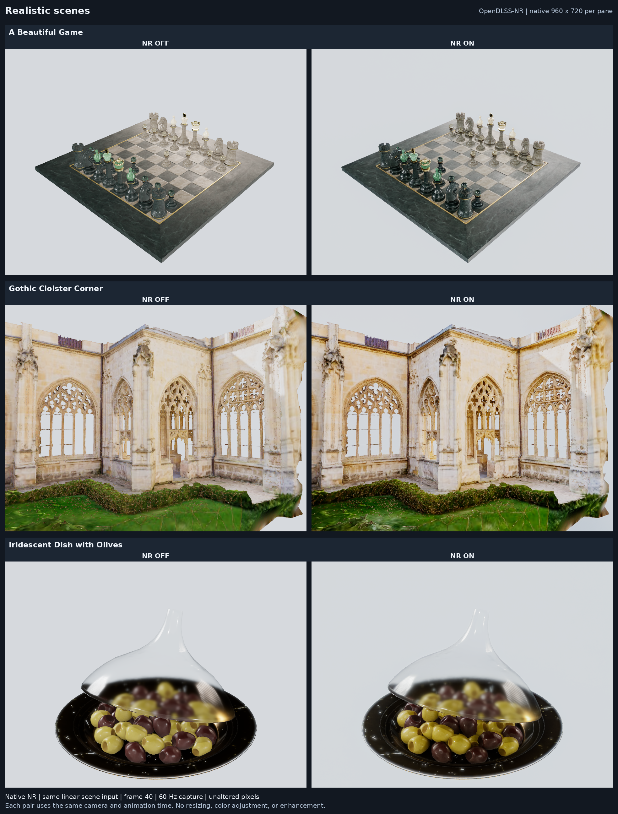
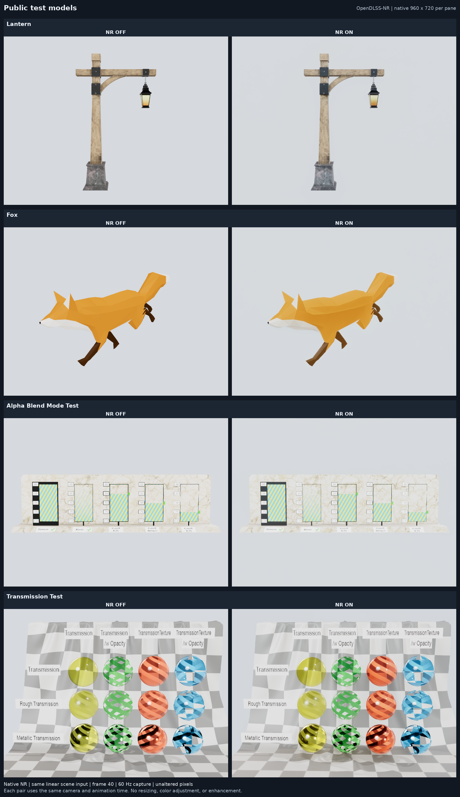
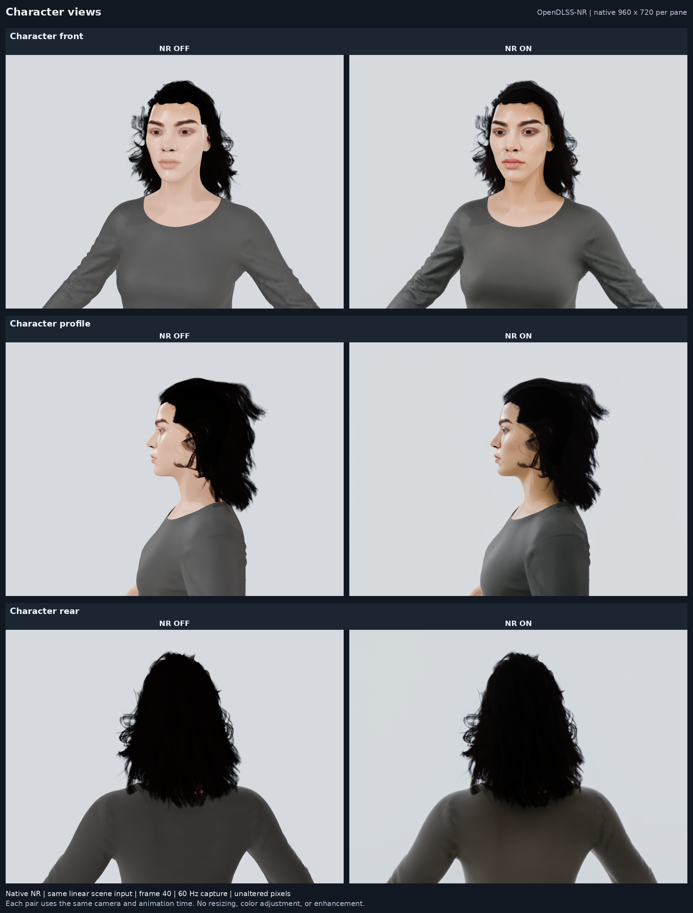
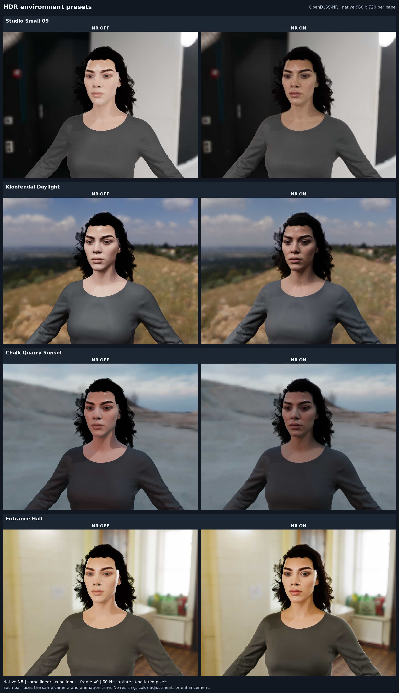

# OpenDLSS-NR Linux 客户端

在 Linux/X11 桌面查看实时视频的神经重渲染（NR）和插帧效果，也可导入 GLB/glTF，在同一个 Vulkan 设备上渲染 3D 场景和运行 OpenDLSS-NR。NR 保持输入分辨率。Live 的 2×、3×、4× 插帧可选择 NVIDIA 硬件光流、RIFE 或 MAKO；这三项都使用相邻视频帧。它们独立于 NR，与 NVIDIA 游戏引擎集成的 DLSS Frame Generation 属于不同实现。[OpenDLSS-NR 上游](https://github.com/maanHimself/OpenDLSS-NR)

## 1. 安装并构建客户端

下面的命令面向 **Ubuntu 24.04 x86_64**。登录桌面时选择 **Ubuntu on Xorg**。在桌面终端运行 `echo "$XDG_SESSION_TYPE"` 应显示 `x11`。首次构建需联网下载固定版本的 Filament 等依赖，预留数 GB 磁盘。所有后续命令均从仓库根目录执行。

```sh
sudo apt update
sudo apt install -y git curl unzip ca-certificates build-essential cmake ninja-build pkg-config \
  clang libc++-dev libc++abi-dev libvulkan-dev libsdl2-dev libx11-dev libxcomposite-dev \
  libxcb1-dev libxi-dev libxxf86vm-dev libgl-dev libedit2 libxml2 libzstd1 \
  python3 python3-gi gir1.2-gtk-3.0 nodejs
git clone https://github.com/AirDryingFish/opendlss-nr-client.git
cd opendlss-nr-client
./scripts/check-features.py --only build
NR_BUILD_JOBS=4 ./scripts/linux/build.sh
```

仓库直接包含测试人物、写实场景和四个 HDR 环境，普通 Git 克隆即可取得。脚本将程序和配套资源写入 `build/`，后续构建复用编译缓存。[测试资产与许可](assets/README.md)

**首次试跑可只采集原画。** 以下检查会在当前桌面创建一个临时双色小窗，分别从屏幕选区和窗口读取像素。检查通过后运行第二行，再点击要预览的视频窗口。按 **Esc** 退出。

```sh
./scripts/check-features.py --only chooser region window
./scripts/run-client.sh --live --window pick --nr 0
```

## 2. 按功能配置和验证

| 要使用的功能 | 所需环境 | 实际运行检查 |
| --- | --- | --- |
| Live 原画预览 | 可访问的 X11 桌面、SDL2。捕获被遮挡的窗口另需 XComposite。启动选择页使用 GTK 3。 | `./scripts/check-features.py --only chooser region window` |
| Live NR | NVIDIA Ada（计算能力 8.9）或更新、满足 `check-gpu.sh` 的 Vulkan 驱动、兼容的本地 NR 权重 | `./scripts/check-features.py --only nr` |
| Debug 3D 查看器 | 上述 NR 环境、可显示窗口的 X11 桌面、仓库资产 | `./scripts/check-features.py --only debug` 加载内置人物，渲染三帧 |
| NVIDIA 硬件光流 | 支持光流的 NVIDIA GPU、驱动的光流与 CUDA 库、构建时可用的 `nvcc` | `./scripts/check-features.py --only flow` |
| RIFE v4.6 | 支持 FP16 和 8 位存储的 Vulkan GPU、RIFE 插件及其权重 | `./scripts/check-features.py --only rife` |
| MAKO FG v1.24 | x86_64 Linux、支持时间线信号量及外部内存/信号量 FD 的 Vulkan GPU、MAKO 模型及运行库 | `./scripts/check-features.py --only mako` |

### 启用 OpenDLSS-NR 和 Debug

先运行 `./scripts/check-gpu.sh` 查看驱动的扩展、特性及队列检查。已在 RTX 4080 SUPER 和 NVIDIA 595.99.02 上运行。缺少 `VK_EXT_shader_float8`、`VK_NV_cuda_kernel_launch` 等必需功能时，使用 Ubuntu 的驱动管理工具安装支持这些功能的 NVIDIA 驱动，重启后重新检查。[Ubuntu 驱动安装](https://ubuntu.com/server/docs/how-to/graphics/install-nvidia-drivers/)

从有权使用的 NVIDIA RTX Remix 1.6.1 x64 游戏运行包提取本机权重。下列命令下载官方包，校验已验证版本的 DLL，再静态读取其资源。DLL 和提取权重受原许可约束，保存在本地。`models/nr` 必须是新目录；已经提取过的用户可直接运行最后一行。[NVIDIA 官方发布](https://github.com/NVIDIAGameWorks/rtx-remix/releases/tag/remix-1.6.1) · [提取器说明](scripts/model/README.md)

```sh
remix_dir="${XDG_CACHE_HOME:-$HOME/.cache}/opendlss-nr-client/remix-1.6.1"
mkdir -p "$remix_dir"
curl -fL --retry 3 -o "$remix_dir/remix-x64.zip" \
  https://github.com/NVIDIAGameWorks/rtx-remix/releases/download/remix-1.6.1/rtx-remix-for-x64-games-release-remix-1.6.1.zip
unzip -n "$remix_dir/remix-x64.zip" nvngx_dlssnr.dll -d "$remix_dir"
echo "2bc19bc09a7b89dd44f73e2ac0108fcc586e2154bdd0830f242f4f040e28789f  $remix_dir/nvngx_dlssnr.dll" | sha256sum -c - && \
  node scripts/model/scripts/extract-model.mjs "$remix_dir/nvngx_dlssnr.dll" models/nr
./scripts/check-features.py --only nr debug
```

### 选择视频插帧后端

三个后端均支持 2×、3× 和 4×，可以只安装所需的一项。插帧可以在 NR 关闭时独立使用。

| 后端 | 安装步骤 |
| --- | --- |
| **NVIDIA optical flow** | 安装 NVIDIA CUDA Toolkit，将 `nvcc` 加入 `PATH`，重新运行 `./scripts/linux/build.sh`。驱动需提供 `libnvidia-opticalflow.so.1`。[Ubuntu 24.04 安装命令](README-LINUX.md#安装-nvidia-硬件光流工具链) |
| **RIFE v4.6** | 运行 `./scripts/linux/prepare-rife.sh`，下载固定版本源码和模型，校验权重，编译 ncnn Vulkan 插件。[上游实现](https://github.com/nihui/rife-ncnn-vulkan) |
| **MAKO FG v1.24** | 运行 `./scripts/linux/prepare-mako.sh`，下载并校验运行库和模型，编译 Vulkan 适配器。权重供非商业研究与教学使用（CC BY-NC 4.0）；预编译运行库按上游另订的免费非商业条款提供。[项目](https://github.com/eugeniosegala/MAKO) · [模型卡与许可](https://huggingface.co/eugeniosegala/MAKO-FG) |

升级已有安装后，重新运行所选插件的安装脚本，以启用多倍率接口。查看已安装的后端用 `./scripts/run-client.sh --live --list-fg-backends`。验证 GPU 能实际生成中间帧用以下检查，其中第一条对所选后端逐一运行三个倍率。

```sh
./scripts/check-features.py --only rife
./scripts/check-features.py --only flow mako --multiplier 4
./scripts/check-features.py --json
```

不传 `--only` 时检查所有运行功能。退出码 `0` 表示所选检查全部通过，`2` 表示至少一项失败。未安装的可选后端也会标记为失败，失败项附有原因和修复方向。需要机器可读结果时添加 `--json`。

## 3. 开始使用

运行 `./scripts/run-client.sh` 打开 **Live / Debug** 选择页。选定模式后才启动渲染或采集。

**Live** 中选择 **Pick window…** 后点击播放视频的窗口，或选择 **Pick region…** 拖框。视频预览中点击 **Settings** 或按 **F1** 打开设置面板，可以开关 NR、开关帧生成、选择算法、倍率和采集 FPS，并查看采集率、预览提交率和垂直同步状态。**G** 开关插帧，**B** 切换已安装的算法，**N** 开关 NR。



图中采集的是正在平移的国际象棋桌面画面，MAKO 设为 4×，NR 关闭，采集上限为 24 FPS。[场景来源与署名](assets/realistic-scenes/README.md)

```sh
# 选一个窗口，以 30 FPS 采集，独立运行 MAKO 3×
./scripts/run-client.sh --live --window pick --fps 30 --nr 0 --frame-gen 1 --fg-backend mako --fg-multiplier 3
# 框选区域，同时运行 NR 和 RIFE 4×
./scripts/run-client.sh --live --region pick --fps 30 --nr 1 --frame-gen 1 --fg-backend rife --fg-multiplier 4
```

30 FPS 动态输入在 2× / 3× / 4× 时分别以 60 / 90 / 120 FPS 为目标。3× 在相邻真实帧的 1/3 和 2/3 处生成画面，4× 在 1/4、1/2、3/4 处生成。插值需等到下一张源帧，实际流畅度受 GPU 耗时和显示器刷新率影响。输出赶不上目标时，预览优先显示真实帧，跳过错过显示时机的插值帧。区域采集时请把预览放在选区外，预览与选区重叠会暂停采集以避免递归画面。

**Debug** 加载内置人物。**Model → Assets / scene** 列出仓库内模型，**Browse…** 可从其他文件夹导入，也可拖入文件。glTF 的外部缓冲区与纹理需保留相对路径。**Scene** 可调整背景色、HDR 环境和 MSAA。左键旋转、中键平移、滚轮缩放、**R** 重新取景、**N** 开关 NR。渲染分辨率随实际窗口尺寸变化。

```sh
./scripts/run-client.sh --debug
./scripts/run-client.sh --debug assets/test-static.glb --environment-preset chalk-quarry-sunset
```

## 效果

以下四组图片覆盖全部 **14 个案例视图**。每行左侧为 **NR OFF**，右侧为 **NR ON**（`temporal=1`）；每对画面保持相同模型、材质、相机、照明和 **960×720** 渲染分辨率，动画固定在同一帧。图片来自当前客户端的 OpenDLSS-NR 开关输出，逐对配置见[对比记录](docs/verification/nr-comparisons-2026-11-11.json)。



国际象棋桌面、哥特式回廊扫描和玻璃餐具三组对比。模型、默认视角和来源许可见[写实场景](assets/realistic-scenes/README.md)。



Lantern、Fox、AlphaBlendModeTest 和 TransmissionTest 四组对比，分别覆盖金属与贴图、骨骼动画、透明混合和透射材质。模型来源与运行命令见[测试资产](assets/README.md)，导入与动画检查见[案例验证](docs/verification/public-cases-2026-11-11.json)。



默认人物的正面、侧面与背面三组对比。



摄影棚、白天户外、日落与室内四组对比；各预设使用相同人物、相机、IBL 强度和环境旋转。预设来源与许可见[环境照明](assets/README.md#环境照明)。

## 文档与许可

[Linux 构建、故障排查与性能测量](README-LINUX.md) · [网络与内核文档](docs/README.md) · [上游说明](docs/UPSTREAM-README.md) · [测试记录](docs/verification/)

源码基于 OpenDLSS-NR `9d08f4184bbcb9d858e2fb7a7834ec0837a9d2f1`，按 MIT 许可发布。Filament v1.77.0、可选后端、测试资产及 NVIDIA 权重各自适用其原始条款。本项目为独立社区实现。[LICENSE](LICENSE) · [NOTICE](NOTICE) · [资产许可](assets/README.md)
