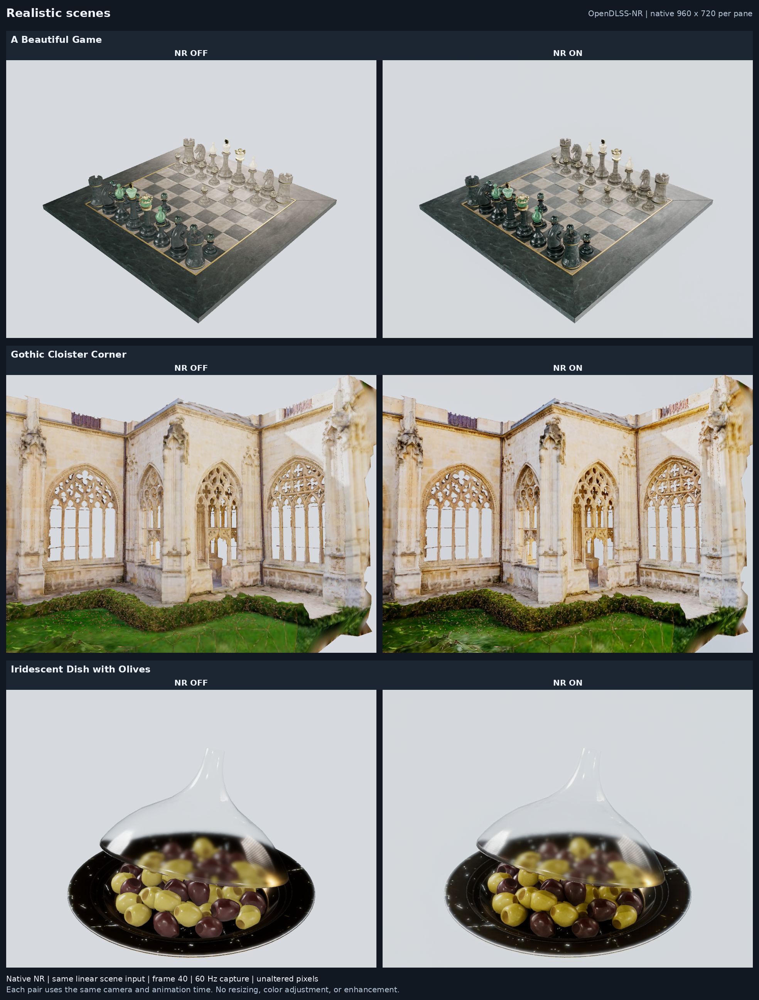
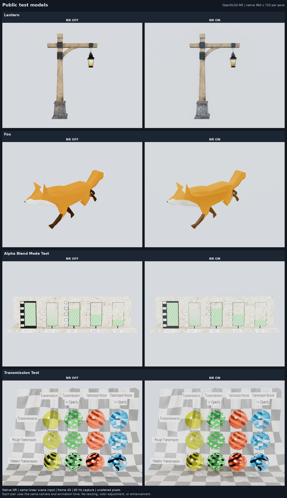
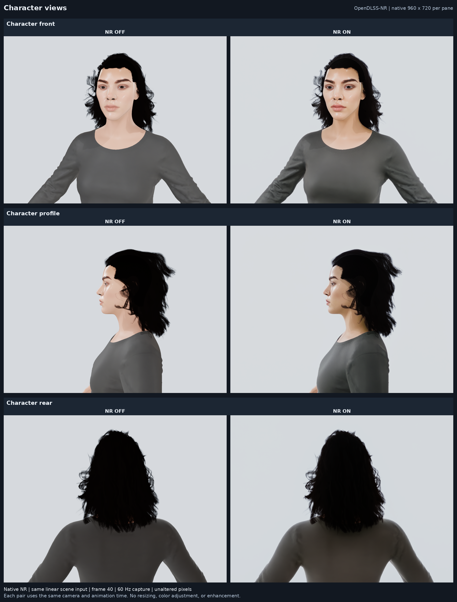
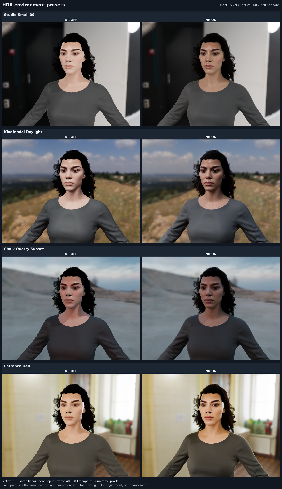

# OpenDLSS-NR Linux 客户端

基于 [OpenDLSS-NR](https://github.com/maanHimself/OpenDLSS-NR) 的 Linux/X11 原生查看器：用 Filament 加载 glTF/GLB，在同一 Vulkan 设备中完成场景渲染、运动向量、FP8 Tensor Core NR 和时间合成。NR 输入与输出分辨率相同，用于神经重渲染；不包含 DLSS-SR 超分辨率。

## 效果

以下四组图片覆盖全部 **14 个案例视图**。每行左侧为 **NR OFF**，右侧为 **NR ON**（`temporal=1`）；每对画面保持相同模型、材质、相机、照明和 **960×720** 渲染分辨率，动画固定在同一帧。图片来自当前客户端的 OpenDLSS-NR 开关输出，逐对配置见[对比记录](docs/verification/nr-comparisons-2026-11-11.json)。



国际象棋桌面、哥特式回廊扫描和玻璃餐具三组对比。模型、默认视角和来源许可见[写实场景](assets/realistic-scenes/README.md)。



Lantern、Fox、AlphaBlendModeTest 和 TransmissionTest 四组对比，分别覆盖金属与贴图、骨骼动画、透明混合和透射材质。模型来源与运行命令见[测试资产](assets/README.md)，导入与动画检查见[案例验证](docs/verification/public-cases-2026-11-11.json)。



默认人物的正面、侧面与背面三组对比。



摄影棚、白天户外、日落与室内四组对比；各预设使用相同人物、相机、IBL 强度和环境旋转。预设来源与许可见[环境照明](assets/README.md#环境照明)。

## 运行条件

- **Ubuntu 24.04 amd64，X11 桌面**。本版窗口使用 SDL X11 后端。
- **NVIDIA Ada / 计算能力 8.9 或更新 GPU**；已验证 RTX 4080 SUPER，驱动 **595.99.02**。
- 驱动必须实际暴露 `VK_EXT_shader_float8`、`VK_KHR_cooperative_matrix`、`VK_NV_cooperative_matrix2`、`VK_NV_cuda_kernel_launch` 等能力。安装后运行检查器，以实际扩展、特性和队列检查为准，不能只看驱动版本。
- 首次构建需要联网下载固定版本依赖；模型权重另行准备，不随仓库提供。

## 安装与首次启动

先安装 Ubuntu 的构建工具和桌面运行依赖，再获取源码。已有源码目录可跳过克隆，在仓库根目录构建：

```sh
sudo apt update
sudo apt install -y build-essential cmake ninja-build git curl unzip ca-certificates python3 nodejs \
  libvulkan-dev libx11-dev libxcb1-dev libxi-dev libxxf86vm-dev libgl-dev \
  libedit2 libxml2 libzstd1
git clone https://github.com/AirDryingFish/opendlss-nr-client.git
cd opendlss-nr-client
NR_BUILD_JOBS=4 ./scripts/linux/build.sh
```

如果拿到的是离线 Git 包，可用 `git clone /path/to/opendlss-nr-client.bundle opendlss-nr-client` 取得同一份源码和测试资产。

脚本下载固定版本的 Vulkan-Headers、volk、glslang 和 Filament，并按需准备用户目录内的 Clang/libc++ 工具链。构建结果在 `build/`；依赖和编译缓存默认位于 `${XDG_CACHE_HOME:-$HOME/.cache}/opendlss-nr-client/`，可用 `NR_DEPS_DIR` / `NR_BUILD_DIR` 覆盖。更多选项见 [Linux 详细说明](README-LINUX.md)。脚本本身不调用 sudo，也不安装或更换显卡驱动。

从 NVIDIA 官方 [RTX Remix 1.6.1 发布页](https://github.com/NVIDIAGameWorks/rtx-remix/releases/tag/remix-1.6.1) 下载并解压 [x64 游戏运行包](https://github.com/NVIDIAGameWorks/rtx-remix/releases/download/remix-1.6.1/rtx-remix-for-x64-games-release-remix-1.6.1.zip)，在其中找到兼容的 `nvngx_dlssnr.dll`（NR 310.8.0）。用自己的 DLL 路径替换下面的示例路径：

```sh
node scripts/model/scripts/extract-model.mjs "/path/to/nvngx_dlssnr.dll" models/nr
./scripts/check-gpu.sh
./scripts/run-client.sh
```

`models/nr` 必须是尚不存在的新目录。提取器只读取 DLL 的 PE 资源，不加载或执行 DLL，无需 Wine 或 npm 包。已验证 DLL 的 SHA-256 与提取格式见 [权重提取说明](scripts/model/README.md)。客户端要求 **71 个网络块、153 个张量、11 个阶段**，加载时校验阶段长度与 SHA-256。

检查器退出码：`0` 为前置能力通过，`2` 为能力不足，`1` 为检查器或 Vulkan 加载失败；通过检查不代表已运行网络或完成性能测量。可用 `./scripts/check-gpu.sh --json` 导出结果。

默认加载仓库内的 `assets/test-static.glb` 与本地 `models/nr`。发布或搬移已构建程序时，应保留完整 `build/`、`assets/` 和本地 `models/` 目录。

## 加载模型与操作

```sh
./scripts/run-client.sh "/path/to/model.glb"
./scripts/run-client.sh "/path/to/model.gltf" "/path/to/environment.hdr"
./scripts/run-client.sh "/path/to/model.glb" --width 1280 --height 720
./scripts/run-client.sh --environment-preset chalk-quarry-sunset
./scripts/run-client.sh --model "/path/to/other/nr"
```

初始窗口请求为 **1024×1024**；`--width` / `--height` 只改变初始尺寸。场景、NR 和界面自动跟随窗口实际客户区大小，拖动边缘或最大化即可调整分辨率；最小化时暂停渲染，恢复时重置时间历史。

启动后，顶部 **Model → Assets / scene** 自动列出 `assets/` 及子目录中的 GLB/glTF。点击 **Browse...** 可浏览内置资产或外部文件夹，选中模型后点击 **Open**；也支持输入路径或拖入文件。相邻的 `view.json` 会自动提供初始视角和照明，未配置时按模型边界自动取景。导入失败时保留当前场景，并在界面显示错误。

支持 PNG/JPEG 贴图；KTX2 暂不支持，请先转换。glTF 引用的外部缓冲区和图片需一同保留。超过 **256 个骨骼**的蒙皮会明确拒绝导入。

| 操作 | 控制 |
| --- | --- |
| 围绕模型旋转 / 平移 / 缩放 | 左键拖动 / 中键拖动 / 滚轮 |
| 自由观察 / 移动 | 右键拖动 / WASD、Q/E；Shift 加速 |
| 重新取景 | R |
| 开关 NR / 时间历史 | N / T |
| 切换 HDR 背景 | B |

**Scene → Background color** 可选择 sRGB 纯色背景，保留 IBL 环境照明；**HDR background** 可切回环境图。**Scene MSAA** 默认 4×，可选 off / 2× / 4× / 8×，只改变场景采样，NR 仍按窗口分辨率运行。

**Scene → Environment preset** 提供摄影棚、白天户外、日落与室内四种 HDR 环境。选择后会更新照明与反射、显示 HDR 背景并重置 NR 时间历史；仍可用 **Background color** 切回纯色。切换保留当前 IBL 强度和环境旋转，加载失败时保留当前环境。预设来源、许可和文件见[环境照明](assets/README.md#环境照明)。

默认人物测试模型为当前姿态的静态烘焙版本，含 **121,968 个顶点、23 张嵌入贴图，无动画**；其来源、校验值及烘焙说明见 [assets/README.md](assets/README.md)。其他兼容资产仍可使用上游骨骼动画功能。

## 测量性能

```sh
mkdir -p reports-local
./scripts/run-client.sh --width 1024 --height 1024 --nr 1 --temporal 1 \
  --benchmark-warmup 30 --benchmark-frames 120 \
  --benchmark-output "$PWD/reports-local/1024-benchmark.json"
```

报告分别记录网络 GPU、整帧 GPU 和整帧 wall time 的中位数与 P95，以及设备、驱动、实际分辨率及 NR 状态。测量期间保持窗口尺寸不变；调整窗口或最小化会终止基准。验收基准要求默认内核路由，实验性 `DLSS5VK_*` 路由覆盖会被拒绝。

[历史验证记录](docs/verification/)包含材质路由修复前的性能报告，不应当作当前版本成绩。请以上述命令在自己的设备上测量；NR 关闭或样本不足的结果不能代表 NR 性能。

## 文档与来源

- [Linux 详细说明](README-LINUX.md)：构建选项、窗口行为和本地验证记录。
- [网络与实现文档](docs/README.md)：网络结构、数值约定、内核和帧合成。
- [上游 README 归档](docs/UPSTREAM-README.md)：原始 Windows 构建与上游参考数据。
- 源码基于 OpenDLSS-NR `9d08f4184bbcb9d858e2fb7a7834ec0837a9d2f1`，采用 [MIT](LICENSE)；第三方说明见 [NOTICE](NOTICE)。Filament v1.77.0 及其补丁采用 Apache-2.0。
- NVIDIA DLL 与提取权重不随源码分发，不属于源码 MIT 许可证范围；测试资产信息单独列于 [assets/README.md](assets/README.md)。本项目与 NVIDIA 无隶属、背书或支持关系。
